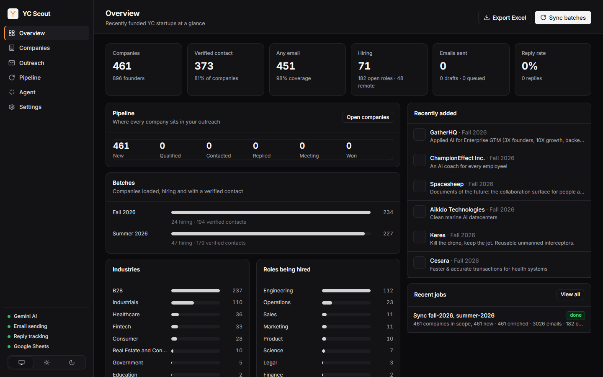
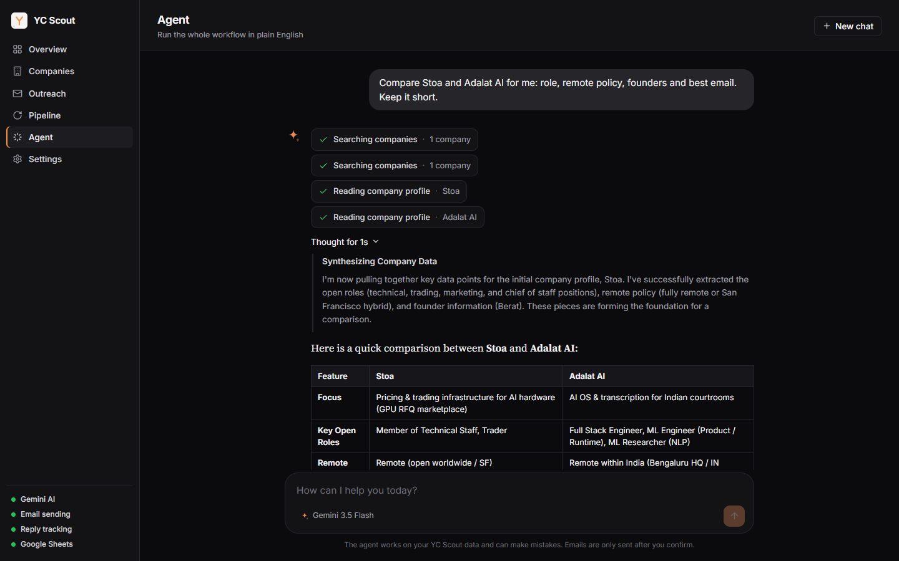
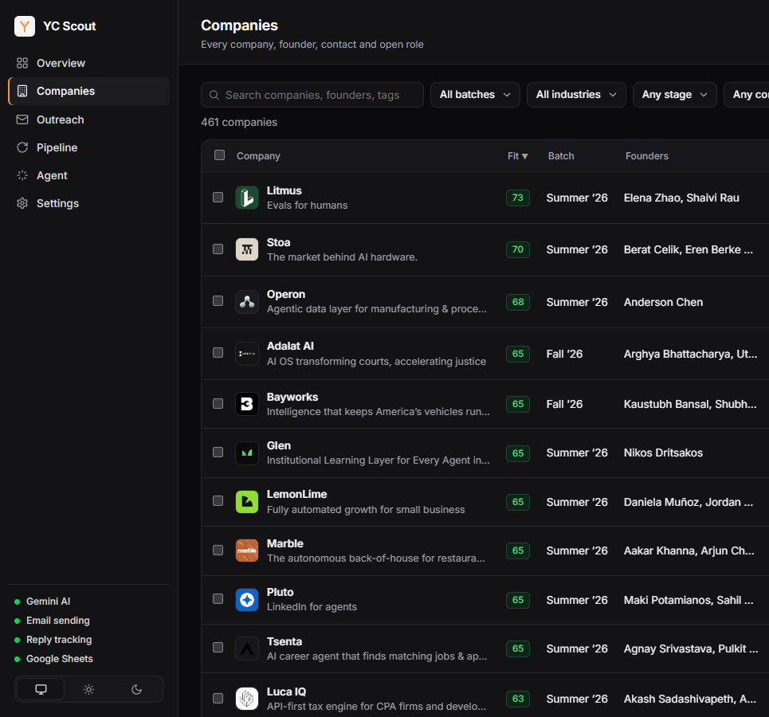
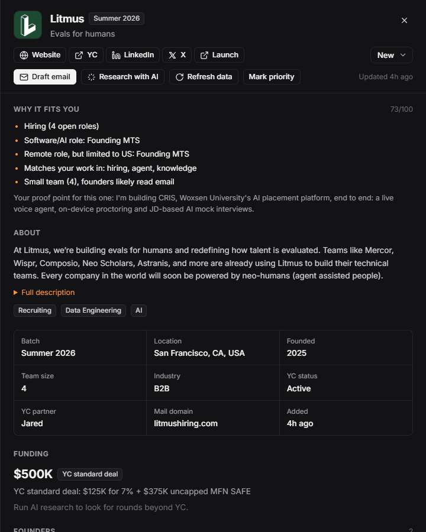
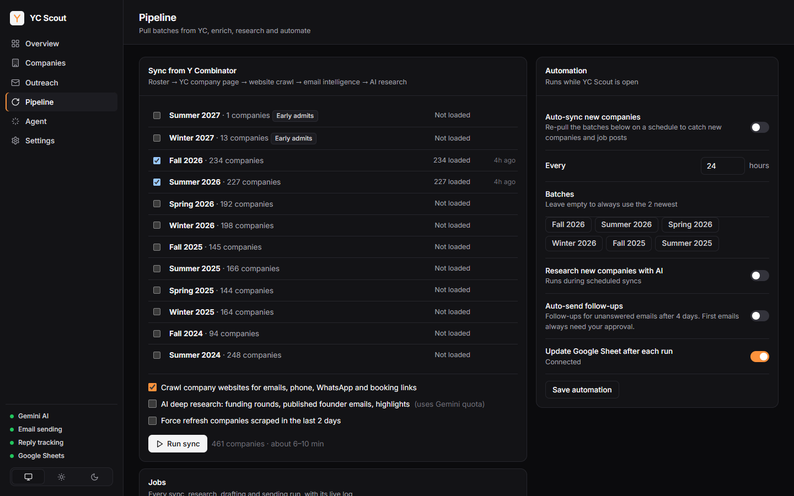
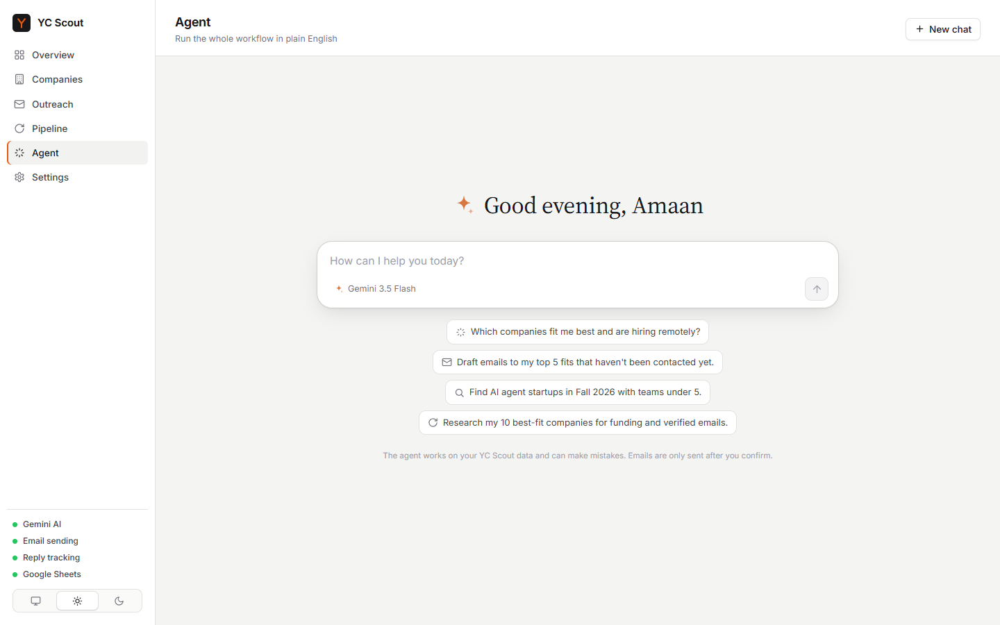

<div align="center">

<a href="https://github.com/amaancoderx/YC-Scout">

</a>

<br/>
<br/>

<div align="center">
    <strong>Find recently funded Y Combinator startups, collect their founders, emails, funding and open roles, and run outreach that sounds like you.
    </strong>
    <br />
    <br />
</div>

[](https://www.python.org/)
[](https://fastapi.tiangolo.com/)
[](https://aistudio.google.com/apikey)
[](https://www.sqlite.org/)
[](https://github.com/amaancoderx/YC-Scout/commits)
[](LICENSE)

</div>

# YC Scout

YC Scout is a local dashboard and AI agent for sourcing recently funded Y Combinator companies and reaching their founders. It pulls every company in a batch, finds the founders and the best way to email them, scores each company against your own profile, and runs approval-gated email outreach with reply tracking and follow-ups. Everything runs on your machine, stores in one SQLite file, and mirrors to Excel or a live Google Sheet.

A real sync of the two newest batches (Fall 2026 + Summer 2026) produced **461 companies**, **896 founders**, **3,026 email addresses** (373 companies with a verified or inferred contact), **182 open roles** (48 remote) and **100 booking links** in about 8 minutes.

### Installation

#### Windows (one click)

Double-click **`start.bat`**. It creates `.env` from the example, installs the requirements and opens the dashboard at http://127.0.0.1:8000.

#### Any OS

```bash
git clone https://github.com/amaancoderx/YC-Scout.git
cd YC-Scout
pip install -r requirements.txt
cp .env.example .env
python scout.py
```

#### Configuration

Everything is optional. Without any keys YC Scout already syncs batches, founders, jobs, website contacts and email patterns, and drafts emails from your template.

| Feature | Needs (in `.env`) |
|----------|------|
| Sync, enrichment, fit score, Excel / CSV export | nothing |
| Agent, AI deep research, AI-written emails | `GEMINI_API_KEY` (free at [aistudio.google.com](https://aistudio.google.com/apikey)) |
| Sending, reply and bounce tracking | `SMTP_USER` + `SMTP_PASSWORD` (Gmail [App Password](https://myaccount.google.com/apppasswords)) |
| Live Google Sheet | `GOOGLE_SERVICE_ACCOUNT_FILE` + `GOOGLE_SHEET_ID` |

Restart the app after editing `.env`.

#### Alternative

Prefer the terminal? Every step also runs from the CLI. See [Command Line](#command-line).

#### Deploy online (free)

Run it on Render's free plan with a login page, a Turso cloud database and Gmail API sending: see **[DEPLOY.md](DEPLOY.md)**. One click with the included `render.yaml` blueprint.


### Why YC Scout?

Cold outreach to new YC companies usually means hours of tab-hopping and guessed emails. YC Scout replaces that with a pipeline that keeps every fact tied to its source.

| Usual way | With YC Scout |
|--------|----------|
| Scroll the YC directory by hand | Sync a whole batch (200+ companies) in minutes |
| Guess `first@company.com` and hope | Every address labeled verified, inferred, likely or guess, with a mail server check |
| Copy-paste one template to everyone | Fit score per company and an email that cites your most relevant project |
| Track replies in a spreadsheet | Inbox checked hourly, replies and bounces handled, follow-ups threaded |
| Lose track of who was contacted | One pipeline: New, Qualified, Contacted, Replied, Meeting, Won |


## Screenshots

<div align="center">


<br/><sub>Overview: batches, coverage, hiring and your outreach funnel</sub>
<br/><br/>


<br/><sub>Agent: streamed answers with live thinking and tool steps</sub>
<br/><br/>

<table>
<tr>
<td width="50%"><br/><sub>Companies ranked by fit</sub></td>
<td width="50%"><br/><sub>Why a company fits you, funding and founders</sub></td>
</tr>
<tr>
<td width="50%"><br/><sub>Pipeline: sync batches and automation</sub></td>
<td width="50%"><br/><sub>Agent home in light mode</sub></td>
</tr>
</table>

</div>


## Data Honesty Notice

YC Scout never presents a guess as a fact. Every email carries a confidence label and, when it was found rather than built, the page it came from.

| Label | Meaning |
|-------|---------|
| **Verified** | Published on the company's own site or a cited source. AI-reported emails are kept only if YC Scout fetches the cited page and finds the address on it. |
| **Inferred** | Built from the company's own observed address format (`lucas@acme.com` found, so `paul@acme.com`). |
| **Likely** | `first@domain` on a small team whose domain has a working mail server. |
| **Guess** | Another common format, kept as an alternate and never chosen as primary. |

- Funding defaults to the YC standard deal ($500K: $125K for 7% plus $375K uncapped MFN SAFE). Rounds beyond YC appear only with a source link.
- WhatsApp and phone numbers are collected only when a company publishes them. Personal numbers are never guessed.
- The first email to anyone is never sent without your approval. The Agent cannot send on its own; it shows a confirm button.

> Cold email laws apply to you, not the tool. Keep the built-in opt-out line, add a mailing address for commercial email (CAN-SPAM), and respect GDPR legitimate-interest rules when emailing the EU or UK.


## Table of Contents

| | | |
|---|---|---|
| [Sourcing](#sourcing) (7) | [Fit Scoring](#fit-scoring) (5) | [Agent](#agent) (11) |
| [Enrichment](#enrichment) (6) | [AI Research](#ai-research) (5) | [Automation](#automation) (5) |
| [Email Intelligence](#email-intelligence) (6) | [Outreach](#outreach) (7) | [Exports](#exports) (4) |
| [Dashboard](#dashboard) (6) | [Command Line](#command-line) (7) | [Project Structure](#project-structure) (9) |

<details open>
<summary><h3 style="display:inline">Sourcing</h3></summary>

- **Batch roster** - Every company in any YC batch from the public [yc-oss API](https://github.com/yc-oss/api), newest batches preselected.
- **Company pages** - Founders, bios, LinkedIn and X, launch posts, news and socials read from each ycombinator.com company page.
- **Job board** - Every open role with salary, equity, experience, visa and remote location, refreshed on each sync.
- **Incremental sync** - Re-running updates existing companies, adds new ones and closes filled jobs. Notes, stages and outreach stay untouched.
- **No duplicates** - Every company, founder, email, job posting, phone number and news item is stored once. Repeated YC job listings and the same number with or without a country code are merged.
- **No re-collecting** - Companies refreshed in the last 2 days are skipped, websites are re-crawled only after 14 days, and batches synced in the last 12 hours are never re-synced by the Agent. Force refresh overrides all of it.
- **Batch picker** - Sync any mix of batches, including early admits for upcoming ones.

</details>

<details open>
<summary><h3 style="display:inline">Enrichment</h3></summary>

- **Website crawler** - Up to 7 pages per company (home, contact, about, team, careers) for published emails, phones and links.
- **Protected emails** - Decodes Cloudflare-protected addresses, `mailto` links and `name [at] domain` obfuscation.
- **WhatsApp and phone** - `wa.me` links and published numbers, each with the page it was found on.
- **Booking links** - Calendly and cal.com links, plus Instagram, Discord and YouTube.
- **Domain sense** - Follows redirects, detects the real mail domain (for example `.ai` site, `.dev` mailbox) and keeps off-brand addresses out.
- **Parallel and polite** - Concurrent crawling with per-host throttling and retries.

</details>

<details open>
<summary><h3 style="display:inline">Email Intelligence</h3></summary>

- **Pattern learning** - Learns each company's address format from published emails and applies it to every founder.
- **MX checks** - Domains without a mail server are flagged and never chosen as primary.
- **Confidence labels** - Verified, inferred, likely or guess on every address, shown everywhere.
- **Primary contact** - Picks the best address per founder and per company automatically.
- **Manual add** - Add an email you know from the company panel; it becomes verified.
- **Do-not-contact list** - Opt-outs and bounces are suppressed forever.

</details>

<details open>
<summary><h3 style="display:inline">Fit Scoring</h3></summary>

- **Your profile** - Paste your background once in Settings. The AI and the scorer both use it.
- **Strengths** - One line each: `keywords => proof line`, for example `voice, calls => I built a voice agent that places real calls`.
- **Transparent score** - 0 to 100 from hiring, software roles, remote roles open to your country, team size and matched strengths, with reasons listed.
- **Proof line** - Each company gets the most relevant line from your strengths as `{{proof_line}}` in emails.
- **Sorted by default** - The Companies page, exports and the Agent all rank by fit.

</details>

<details open>
<summary><h3 style="display:inline">AI Research</h3></summary>

- **Google-grounded** - Gemini searches Google and reads company pages for funding rounds, published emails, traction and news.
- **Real sources** - Every grounded sentence keeps the URL it came from; anything without a working source is dropped.
- **Email verification** - Emails are kept only if they literally appear on the cited page.
- **Funding beyond YC** - Rounds, amounts, dates and lead investors, each with a source link. The YC batch itself is never counted as a round.
- **Quota aware** - App-wide rate limiting and automatic model fallbacks keep free keys working. When a model's daily free quota runs out, it is skipped until Google resets it. Already-researched companies are skipped, so quota is never spent twice; refresh one from its panel when you want.

</details>

<details open>
<summary><h3 style="display:inline">Outreach</h3></summary>

- **Two drafting modes** - AI-personalized emails per founder, or your own template with variables like `{{hiring_line}}` and `{{proof_line}}`.
- **Targets** - CEO only, all founders, or the company inbox. One first email per company (or per founder), so re-drafting never doubles up. Opted-out addresses are skipped.
- **Review and approve** - Edit any draft, approve one by one or in bulk. Nothing sends without approval.
- **Safe sending** - SMTP with a daily cap, a delay between emails, an opt-out footer and a List-Unsubscribe header.
- **Reply tracking** - The inbox is checked hourly over IMAP; replies move the company to Replied and cancel follow-ups.
- **Bounce handling** - Bounced addresses are added to the do-not-contact list automatically.
- **Threaded follow-ups** - Unanswered emails get a follow-up draft after N days in the same thread, with optional auto-send.

</details>

<details open>
<summary><h3 style="display:inline">Agent</h3></summary>

- **Plain English** - "Draft emails to my top 5 fits that are hiring remotely and haven't been contacted."
- **Real tools** - Searches, reads company profiles, updates stages, starts syncs and research, drafts and approves.
- **Live thinking** - Streams Gemini's thought summaries, each tool step and the answer as it is written.
- **Knows you** - Gets your profile and goal, so it ranks and writes for your situation.
- **Knows the whole dashboard** - A live snapshot (totals, batches, top fits, stages, outreach, running jobs, integrations, rules) comes with every message, and 20 tools cover the rest: companies, jobs, people, drafts it can read and edit, pipeline logs, settings and analytics.
- **Operate everything by prompt** - Sync, refresh, research, draft, edit, approve, send, check replies, follow-ups, exports, Google Sheets, settings, do-not-contact and jobs, all from chat. 33 tools in total.
- **Question cards** - When the Agent needs a decision it shows a clickable card with options, a free-text answer and Submit (keys 1-4 work too). Answered cards collapse to show your choice.
- **Send guard** - Sending shows a "Send N emails now?" card. Only Yes, send (or an explicit typed yes in your next message) sends, never in the same turn, and never twice.
- **Saved chats** - Every conversation is saved locally. Reopen and continue any chat, search, rename or delete one, or delete all.
- **Memory** - Learns lasting facts and preferences across chats ("only remote roles open to India"). View, add or delete memories, turn memory off, or clear it all.
- **Reuses what you have** - Checks the dashboard first and answers from it instead of syncing or researching data that is already there.

</details>

<details open>
<summary><h3 style="display:inline">Automation</h3></summary>

- **Auto-sync** - Re-pull chosen batches every N hours to catch new companies and job posts.
- **Auto-research** - Optionally research new companies with AI during scheduled syncs.
- **Hourly replies** - Inbox scan for replies and bounces while the app is open.
- **Follow-up scheduler** - Creates follow-up drafts and can send them automatically.
- **Headless runs** - Schedule `python scout.py sync` in Windows Task Scheduler or cron to run with the app closed.

</details>

<details open>
<summary><h3 style="display:inline">Exports</h3></summary>

- **Excel** - One workbook with Companies, Founders, Emails, Jobs and Outreach sheets.
- **CSV** - Any of those tables as CSV.
- **Google Sheets** - A live sheet that updates after every sync.
- **Filtered** - Exports respect the current filters or selection.

</details>

<details open>
<summary><h3 style="display:inline">Dashboard</h3></summary>

- **Overview** - Coverage, hiring, batches, industries, roles and your outreach funnel.
- **Companies** - Search, filters (batch, industry, stage, contact quality, hiring, remote jobs, has phone), fit sort, a phone icon on companies with a published number, and bulk actions.
- **Company panel** - Why it fits you, founders with emails, company contacts, funding, jobs, news and outreach history.
- **Outreach** - Drafts, approved, sent, replied and bounced tabs with an editor.
- **Pipeline** - Sync options, live job logs and automation switches.
- **Themes** - System, Light and Dark, remembered per browser.

</details>

<details open>
<summary><h3 style="display:inline">Command Line</h3></summary>

- **`python scout.py`** - Start the dashboard.
- **`python scout.py batches`** - List YC batches and what is loaded.
- **`python scout.py sync [slugs]`** - Sync batches (default: two newest). Flags: `--research`, `--force`.
- **`python scout.py research fall-2026`** - AI research a whole batch, or `all`.
- **`python scout.py export`** - Write an Excel workbook to `data/exports`.
- **`python scout.py sheet`** - Push everything to Google Sheets.
- **`python scout.py replies`** - Check the inbox for replies and bounces.

</details>

<details open>
<summary><h3 style="display:inline">Project Structure</h3></summary>

- **`scout.py`** - CLI and launcher.
- **`ycscout/sources/yc.py`** - YC roster and company pages.
- **`ycscout/enrich/`** - Website crawler, email intelligence and AI research.
- **`ycscout/fit.py`** - Fit score and proof line per company.
- **`ycscout/pipeline.py`** - Sync and research orchestration.
- **`ycscout/outreach.py`** - Drafting, sending, replies and follow-ups.
- **`ycscout/agent.py`** - Gemini agent with tools and streaming.
- **`ycscout/ai.py`** - Gemini client: grounding, structured output, fallbacks, rate limits.
- **`ycscout/web/`** - FastAPI API and the vanilla JS dashboard.

</details>

<br/>

## 🛠️ Tech Stack

| Layer | Tools |
|-------|-------|
| Backend | Python, FastAPI, SQLite (WAL), httpx, BeautifulSoup, dnspython |
| AI | Google Gemini (google-genai): Google Search grounding, URL context, function calling, thought summaries |
| Email | SMTP, IMAP, List-Unsubscribe, threaded follow-ups |
| Frontend | Vanilla JS, marked, DOMPurify, Inter and Source Serif |
| Exports | openpyxl, gspread |

## 🤝 Contributing

Contributions are welcome.

- Open an issue for bugs or ideas
- Submit improvements via PR
- Keep the data honesty rules: never present a guessed email or number as verified

<div align="center">

[](https://github.com/amaancoderx)
[](https://www.linkedin.com/in/amaan-khan-x/)
[](https://amaankhan.xyz)

</div>

## License

MIT License - see [LICENSE](LICENSE)

YC Scout reads public data from Y Combinator's directory and company websites. It is not affiliated with or endorsed by Y Combinator. Use it responsibly: respect each site's terms, keep sending volumes modest, and follow the email laws that apply to you.
